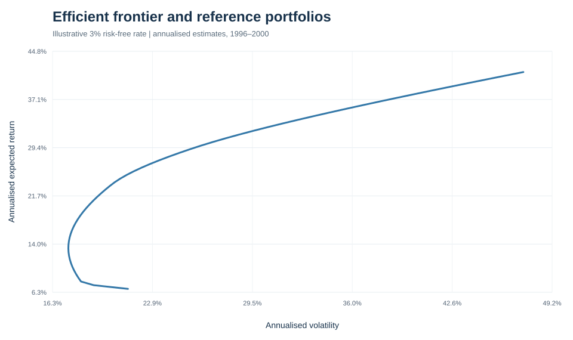
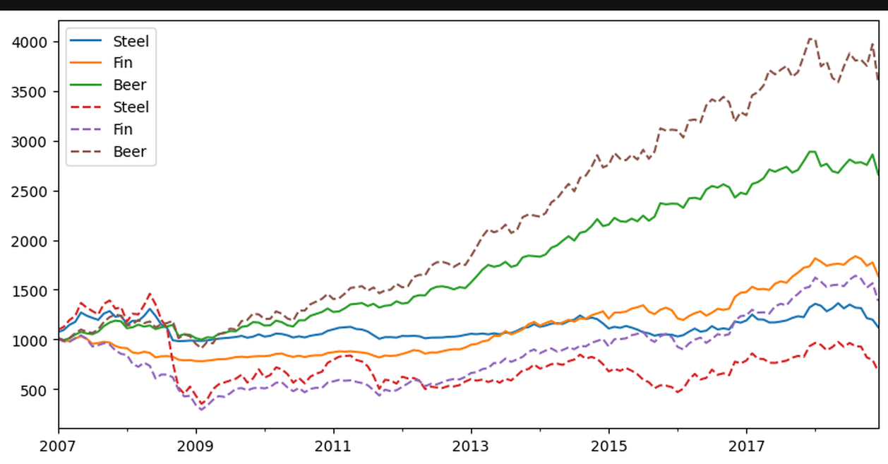
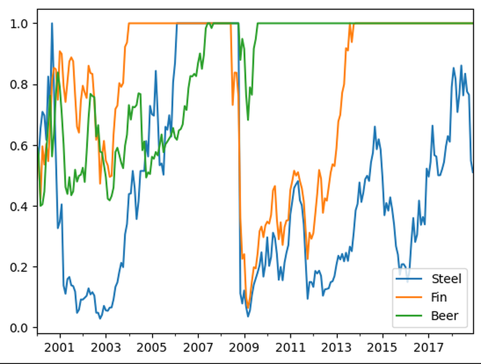
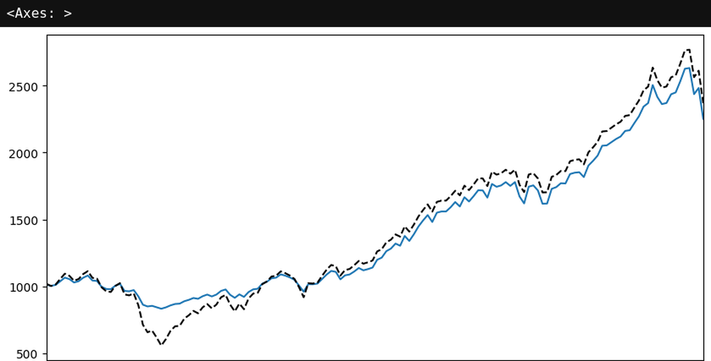
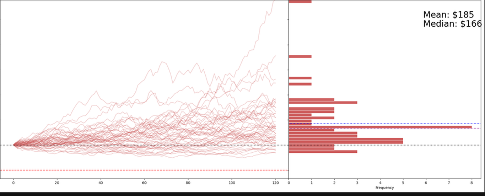
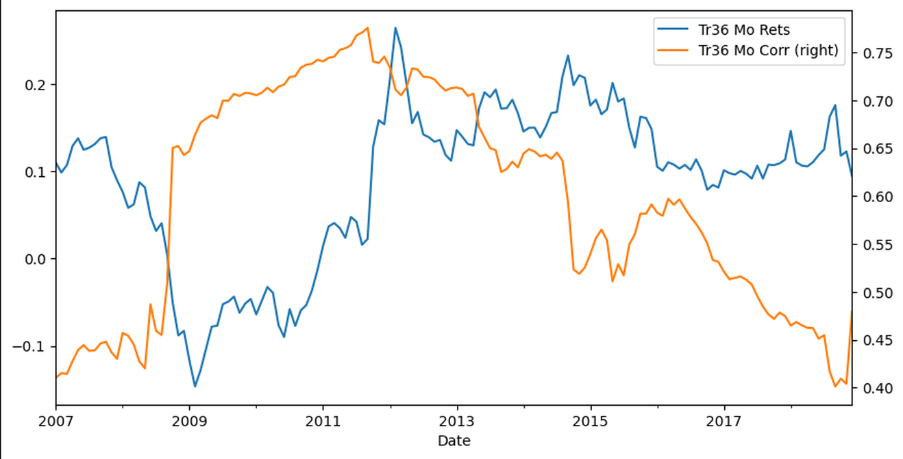

<div align="center">

# Portfolio Optimization Lab

**A Python research toolkit for portfolio construction, risk analysis, stochastic simulation and portfolio insurance.**

[](https://github.com/skate-m/portfolio-optimization-lab/actions/workflows/tests.yml)


[Research notebooks](notebooks/README.md) · [Figure gallery](outputs/README.md) · [Data documentation](data/README.md)

</div>

---

## Overview

Portfolio Optimization Lab is a reproducible, notebook-driven exploration of quantitative portfolio theory. It combines a shared Python toolkit with eight focused research notebooks and a curated gallery of executed results.

The project uses monthly value-weighted returns for the 30 industry portfolios from the **Kenneth R. French Data Library**. The included dataset spans July 1926 to December 2018.

### Research areas

| Area | What is explored |
|---|---|
| Portfolio construction | Two-asset opportunity sets, efficient frontiers, global minimum variance and tangency portfolios |
| Estimation risk | Sensitivity of optimal allocations to expected-return assumptions |
| Stochastic modelling | Geometric Brownian motion and Monte Carlo price paths |
| Portfolio insurance | CPPI, static floors, drawdown constraints and floor-breach analysis |
| Liability valuation | Discount factors, present value and funding ratios |
| Diversification | Rolling industry correlations and market-cap-weighted extensions |

## Selected research outputs

### Global minimum-variance portfolio and capital market line

<p align="center">
  
</p>

*Source: [Notebook 01 — Efficient frontier](notebooks/01_efficient_frontier.ipynb).*

### CPPI wealth versus buy-and-hold risky-asset wealth

<p align="center">
  
</p>

*Source: [Notebook 05 — CPPI and drawdown constraints](notebooks/05_cppi_drawdown_constraints.ipynb).*

### CPPI risky-asset allocation over time

<p align="center">
  
</p>

*Source: [Notebook 05 — CPPI and drawdown constraints](notebooks/05_cppi_drawdown_constraints.ipynb).*

### CPPI wealth paths during the 2007–08 market crash

<p align="center">
  
</p>

*Source: [Notebook 05 — CPPI and drawdown constraints](notebooks/05_cppi_drawdown_constraints.ipynb).*

### Monte Carlo CPPI terminal-wealth distribution

<p align="center">
  
</p>

*Source: [Notebook 06 — Monte Carlo CPPI](notebooks/06_cppi_monte_carlo.ipynb).*

### Trailing returns and correlation since 2007

<p align="center">
  
</p>

*Source: [Notebook 08 — Limits of diversification](notebooks/08_limits_of_diversification.ipynb).*

**Browse all figures:** [outputs/README.md](outputs/README.md).

## Research notebook sequence

Run the notebooks in numerical order. Each notebook uses the shared implementation via `import risk_kit as rk`.

| # | Notebook | Focus |
|---:|---|---|
| 01 | [Efficient frontier](notebooks/01_efficient_frontier.ipynb) | Two-asset and N-asset frontiers, GMV and reference portfolios |
| 02 | [Global minimum variance](notebooks/02_global_minimum_variance.ipynb) | Estimation risk and covariance-driven allocation |
| 03 | [Maximum Sharpe ratio](notebooks/03_maximum_sharpe_ratio.ipynb) | Tangency portfolio, CML and return sensitivity |
| 04 | [Random walks and GBM](notebooks/04_random_walk_gbm.ipynb) | Stochastic price paths and simulation assumptions |
| 05 | [CPPI and drawdown constraints](notebooks/05_cppi_drawdown_constraints.ipynb) | Historical CPPI, risky allocation and drawdown floors |
| 06 | [Monte Carlo CPPI](notebooks/06_cppi_monte_carlo.ipynb) | Scenario paths, terminal wealth and floor breaches |
| 07 | [Liabilities and funding ratio](notebooks/07_liabilities_funding_ratio.ipynb) | Discounting, present value and funding sensitivity |
| 08 | [Limits of diversification](notebooks/08_limits_of_diversification.ipynb) | Rolling correlations and diversification behaviour |

See [notebooks/README.md](notebooks/README.md) for the complete notebook guide, conventions and execution notes.

## Quick start

### 1. Clone the repository

```bash
git clone https://github.com/skate-m/portfolio-optimization-lab.git
cd portfolio-optimization-lab
```

### 2. Create an environment and install dependencies

```bash
python -m venv .venv

# Linux / macOS
source .venv/bin/activate

# Windows PowerShell
# .venv\\Scripts\\Activate.ps1

python -m pip install --upgrade pip
pip install -r requirements.txt
```

### 3. Launch JupyterLab

```bash
jupyter lab
```

Run JupyterLab from the repository root so notebooks can import `risk_kit.py` and resolve the bundled data paths. For reproducible results, use **Kernel → Restart Kernel and Run All Cells**.

### 4. Run the test suite

```bash
pytest -q
```

GitHub Actions runs the test suite on pushes and pull requests to `main`.

## Repository structure

```text
portfolio-optimization-lab/
├── data/
│   ├── ind30_m_vw_rets.csv
│   └── README.md
├── notebooks/
│   ├── README.md
│   ├── 01_efficient_frontier.ipynb
│   ├── 02_global_minimum_variance.ipynb
│   ├── 03_maximum_sharpe_ratio.ipynb
│   ├── 04_random_walk_gbm.ipynb
│   ├── 05_cppi_drawdown_constraints.ipynb
│   ├── 06_cppi_monte_carlo.ipynb
│   ├── 07_liabilities_funding_ratio.ipynb
│   └── 08_limits_of_diversification.ipynb
├── outputs/
│   ├── *.png
│   ├── *.svg
│   └── README.md
├── tests/
│   └── test_risk_kit.py
├── .github/workflows/tests.yml
├── risk_kit.py
└── requirements.txt
```

## Shared toolkit

[`risk_kit.py`](risk_kit.py) contains reusable implementations for:

- Industry data loading and optional market-cap index construction.
- Drawdown, skewness, kurtosis, historical VaR and Gaussian VaR.
- Annualised return, volatility, Sharpe ratio and summary statistics.
- Portfolio return and volatility calculations.
- Long-only GMV, maximum-Sharpe and efficient-frontier optimisation.
- Geometric Brownian motion simulation.
- CPPI backtesting with static and ratcheting drawdown floors.
- Liability discounting, present value and funding ratios.

**Conventions:** returns are decimal simple returns (`0.01` = 1%). Annual rates and expected returns are decimals. The source CSV stores returns in percentage points; `get_ind_returns()` converts them to decimals.

## Data provenance

The bundled `data/ind30_m_vw_rets.csv` file contains 1,110 monthly observations across 30 industries, from July 1926 through December 2018. Source: [Kenneth R. French Data Library](https://mba.tuck.dartmouth.edu/pages/faculty/ken.french/data_library.html).

Optional market-cap-weighted extensions require two additional source files that are not bundled:

- `ind30_m_nfirms.csv` — number of firms by industry.
- `ind30_m_size.csv` — average firm size by industry.

The optional sections explain how to provide these files. Missing values are not fabricated. See [data/README.md](data/README.md).

## Methodology and limitations

- Efficient-frontier examples estimate expected returns and covariance from January 1996–December 2000.
- Monthly returns are geometrically annualised; monthly covariance is multiplied by 12.
- Optimisation examples use fully invested, long-only weights bounded between zero and one.
- The 3% annual risk-free rate is an illustrative assumption, not a live market quote.
- GBM assumes constant drift and volatility with lognormal returns; it omits jumps, volatility clustering and regime changes.
- CPPI is exposed to gap and discrete-rebalancing risk; a floor is not guaranteed in real markets.
- Liability valuation uses a flat discount curve and simplified annual compounding.
- Backtests omit transaction costs, taxes, market impact, liquidity constraints and out-of-sample execution.

This repository is an educational quantitative-finance research project, not investment advice. Historical results and simulated scenarios do not predict future performance.

---

<div align="center">

**Built for learning, experimentation and reproducible quantitative research.**

</div>
