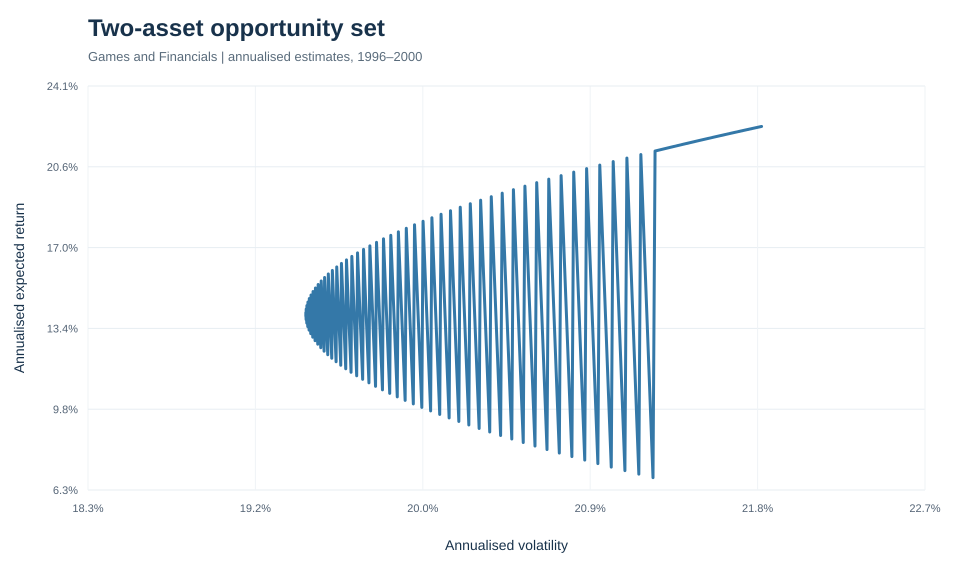
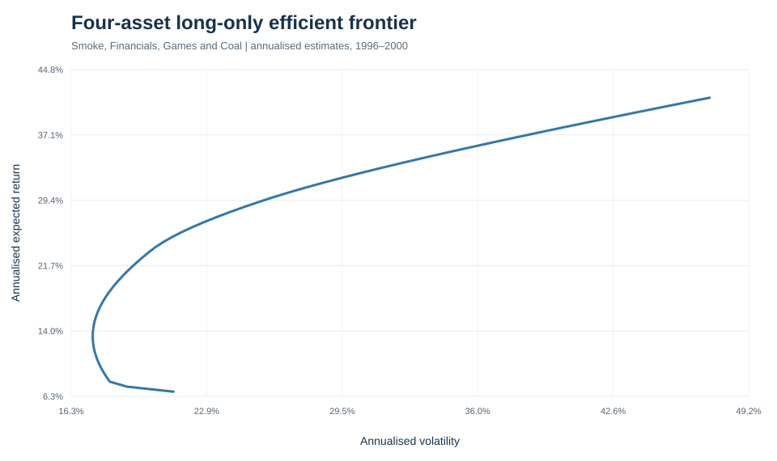

# Portfolio Optimization Lab

A reproducible Python project exploring **mean–variance portfolio optimisation** using monthly value-weighted returns for the 30 industry portfolios published by the Kenneth R. French Data Library.

## Results

### Two-asset opportunity set

Each point represents a fully invested mix of Games and Financials. The curve illustrates how covariance affects the risk–return trade-off.

### Multi-asset efficient frontier

The curve contains long-only, minimum-volatility portfolios for a range of target returns across four industries.

### GMV and capital-market comparison

The comparison distinguishes the covariance-driven global minimum-variance portfolio from the maximum-Sharpe portfolio, which also depends on expected returns and a risk-free-rate assumption.

## Repository structure

```text
portfolio-optimization-lab/
├── data/
│   └── ind30_m_vw_rets.csv
├── notebooks/
│   ├── efficient_frontier.ipynb
│   └── global_minimum_variance.ipynb
├── outputs/
│   ├── two_asset_frontier.svg
│   ├── n_asset_frontier.svg
│   ├── gmv_and_cml.svg
│   └── README.md
├── risk_kit.py
├── requirements.txt
└── README.md
```

## Setup

Python 3.10+ is recommended.

```bash
git clone https://github.com/skate-m/portfolio-optimization-lab.git
cd portfolio-optimization-lab
python -m venv .venv
source .venv/bin/activate
pip install -r requirements.txt
jupyter lab
```

Run notebooks from the repository root. Both notebooks import the shared toolkit with `import risk_kit as rk`.

## Methodology

- The CSV stores returns in percentage points; `rk.get_ind_returns()` converts them to decimal returns.
- The estimation window is January 1996–December 2000.
- Monthly returns are annualised geometrically; monthly covariance is multiplied by 12.
- Optimisation is fully invested and long-only (weights in [0, 1], sum to 1).
- SciPy's SLSQP solver minimises portfolio volatility subject to a target-return constraint.
- The 3% annual risk-free rate is an illustrative assumption, not a live market quote.

## Data provenance

The included `data/ind30_m_vw_rets.csv` snapshot contains 1,110 monthly observations across 30 industries, from July 1926 through December 2018. Source: [Kenneth R. French Data Library — 30 Industry Portfolios](https://mba.tuck.dartmouth.edu/pages/faculty/ken.french/data_library.html). The dataset is committed so the project runs without a manual download.

## Reproducibility and limitations

The notebooks contain the analysis; `risk_kit.py` contains only the shared functions used by those notebooks. Figures are committed separately under `outputs/` and can be refreshed by rerunning the relevant notebook cells.

This is an educational historical-data study, not investment advice. Results are sensitive to estimation windows and model assumptions. Transaction costs, taxes, liquidity, changing constituents and out-of-sample execution are not modelled. Historical results do not predict future returns.
