# Research outputs

A curated gallery of figures generated by the research notebooks in this repository. The collection is organised by research theme so readers can move from portfolio construction to simulation, portfolio insurance and diversification analysis.

> **Reproducibility note:** The PNG figures in this directory were cropped from screenshots of executed notebook outputs to remove notebook interface elements. The plotted content was not redrawn or altered. The three SVG figures are the original vector outputs. Each figure is linked to its source notebook below.

## Figure index

| Research area | Figures |
|---|---:|
| Portfolio construction | 4 |
| Stochastic simulation | 1 |
| CPPI and portfolio insurance | 5 |
| Diversification and market behaviour | 3 |
| **Total** | **13** |

## 1. Portfolio construction

Visualise the feasible risk–return set and the trade-off between expected return and volatility under the portfolio constraints used in the notebooks.

| Figure | Preview | What it shows | Source |
|---|---|---|---|
| Two-asset frontier | 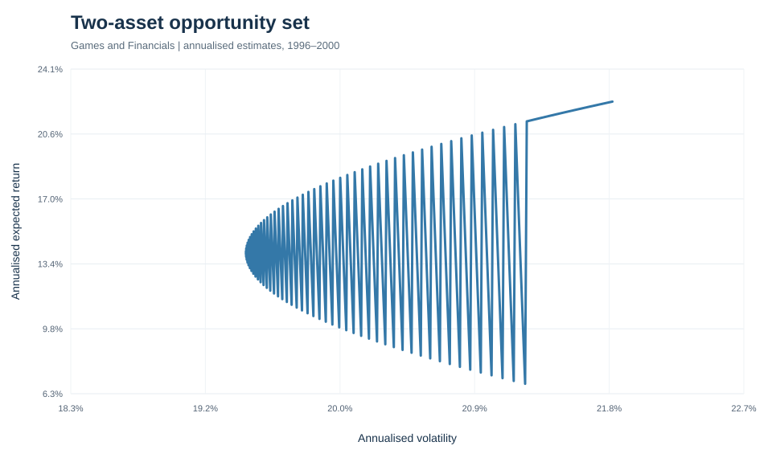 | Feasible risk–return combinations for a two-asset portfolio. | [Notebook 01](../notebooks/01_efficient_frontier.ipynb) |
| N-asset frontier | 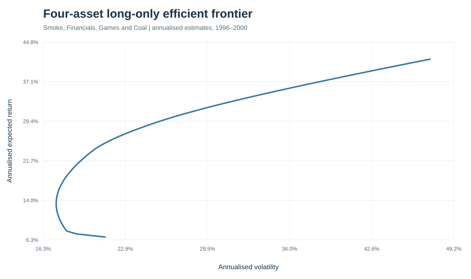 | Long-only efficient frontier for a multi-asset portfolio. | [Notebook 01](../notebooks/01_efficient_frontier.ipynb) |
| GMV and CML | 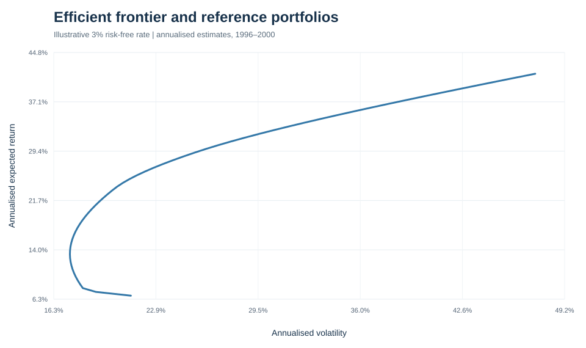 | Global minimum-variance portfolio and capital market line in the risk–return plane. | [Notebook 01](../notebooks/01_efficient_frontier.ipynb) |
| Maximum-Sharpe portfolio | 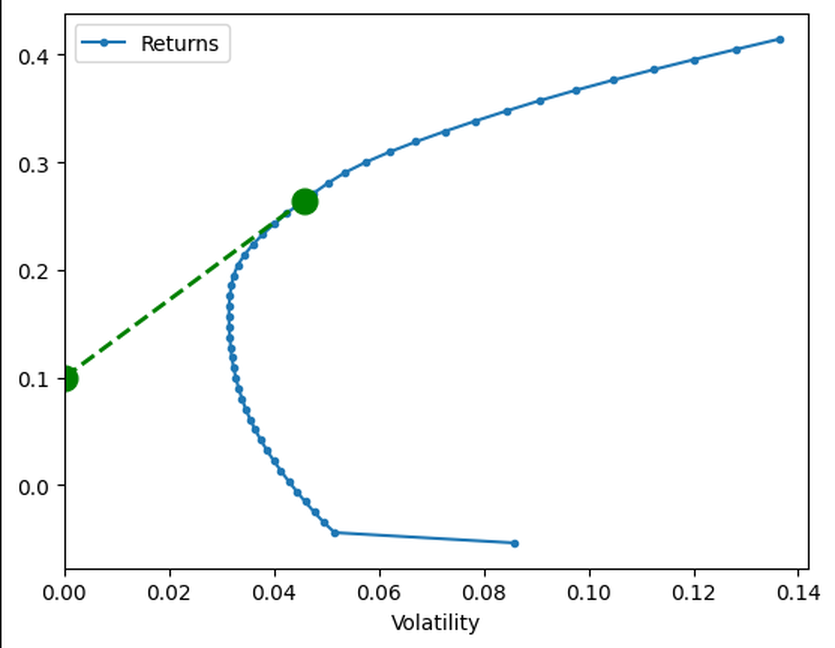 | Efficient frontier with the estimated tangency portfolio and capital market line. | [Notebook 03](../notebooks/03_maximum_sharpe_ratio.ipynb) |

## 2. Stochastic simulation

### Geometric Brownian motion

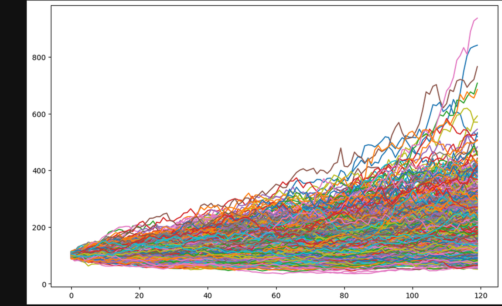

**File:** `04_gbm_simulated_paths.png`  
**Source:** [Notebook 04 — Random walks and GBM](../notebooks/04_random_walk_gbm.ipynb)  
**Purpose:** Illustrates a set of simulated price trajectories under geometric Brownian motion. The paths are scenarios generated from model assumptions, not price forecasts.

## 3. CPPI and portfolio insurance

These figures compare CPPI wealth and risky-asset exposure in historical and simulated settings. They should be interpreted with the model limitations in mind: discrete rebalancing, gaps, transaction costs and market frictions can affect real-world outcomes.

| Figure | Preview | What it shows | Source |
|---|---|---|---|
| Historical wealth comparison | 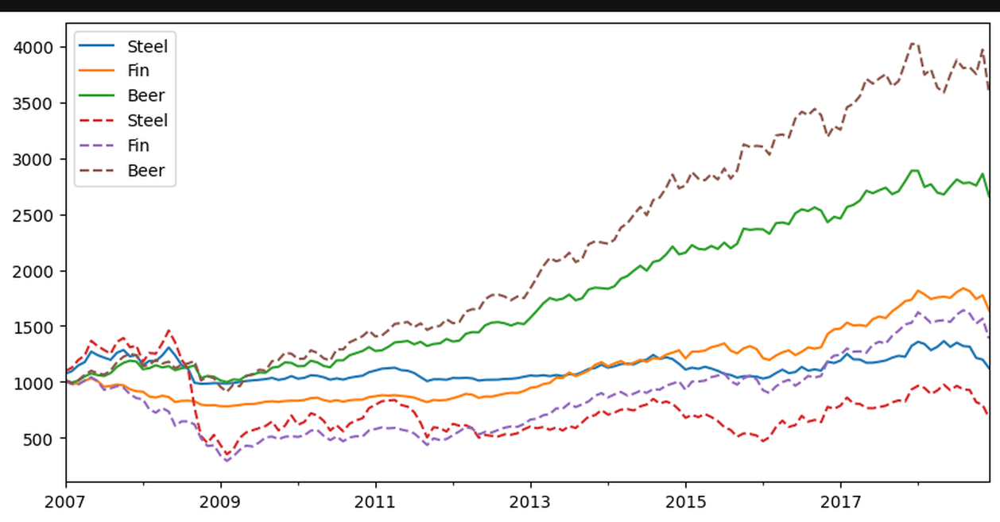 | Buy-and-hold risky wealth versus CPPI wealth for the Steel, Finance and Beer industry series. | [Notebook 05](../notebooks/05_cppi_drawdown_constraints.ipynb) |
| Risky-asset allocation | 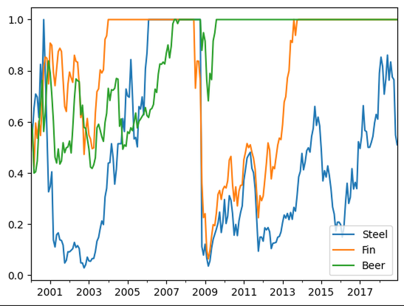 | Historical CPPI allocation to the risky asset over time. | [Notebook 05](../notebooks/05_cppi_drawdown_constraints.ipynb) |
| Crash comparison | 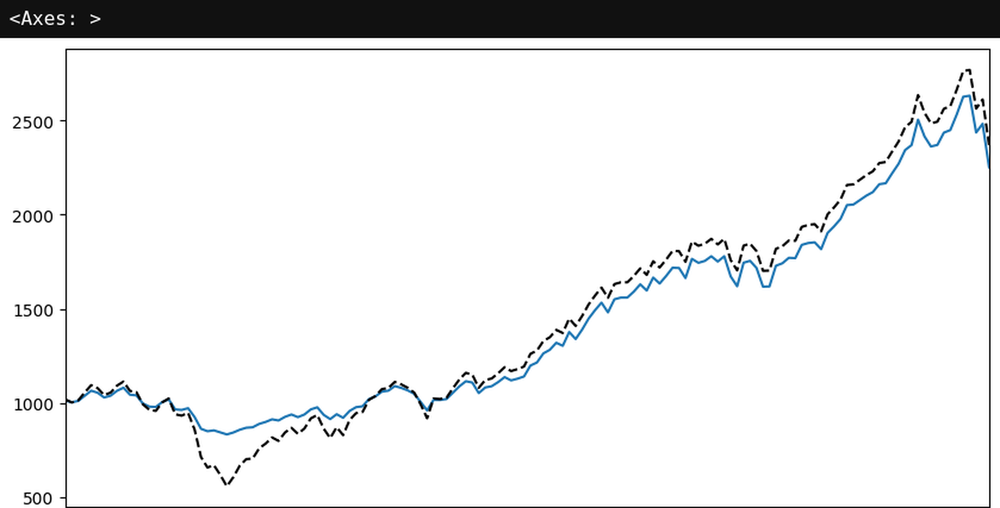 | CPPI and risky-asset wealth paths around the 2007–08 market crash. | [Notebook 05](../notebooks/05_cppi_drawdown_constraints.ipynb) |
| Monte Carlo paths | 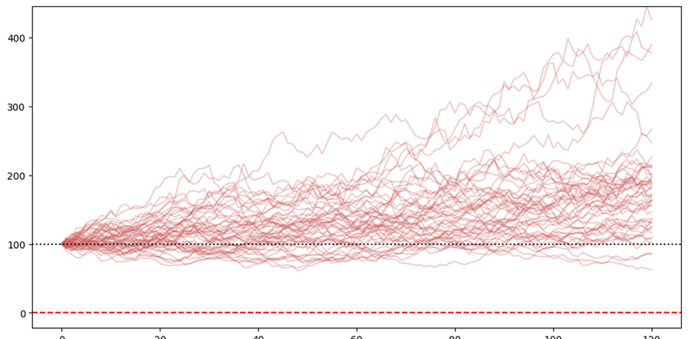 | Simulated CPPI wealth trajectories with the floor reference. | [Notebook 06](../notebooks/06_cppi_monte_carlo.ipynb) |
| Terminal wealth distribution | 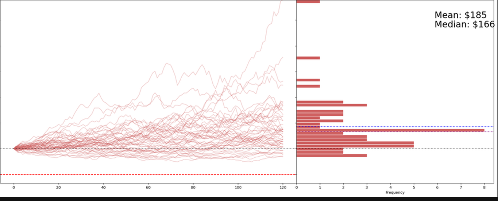 | Simulated terminal-wealth distribution alongside the scenario paths and summary markers. | [Notebook 06](../notebooks/06_cppi_monte_carlo.ipynb) |

## 4. Diversification and market behaviour

The following charts examine market-cap weighting and the behaviour of correlations and returns over time. They are historical illustrations based on the data and assumptions documented in the notebooks.

| Figure | Preview | What it shows | Source |
|---|---|---|---|
| Market-cap-weighted index | 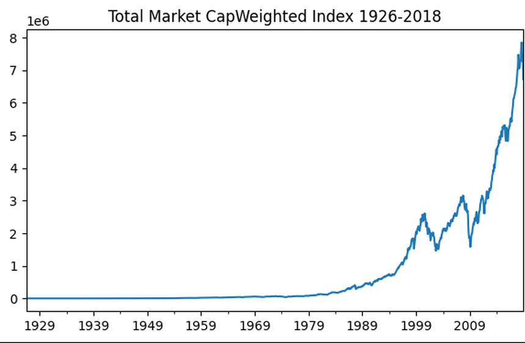 | Historical total-market cap-weighted wealth index. | [Notebook 08](../notebooks/08_limits_of_diversification.ipynb) |
| Rolling correlation | 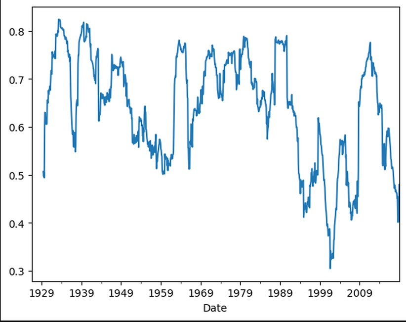 | Rolling 36-month correlation over the available sample. | [Notebook 08](../notebooks/08_limits_of_diversification.ipynb) |
| Returns and correlation | 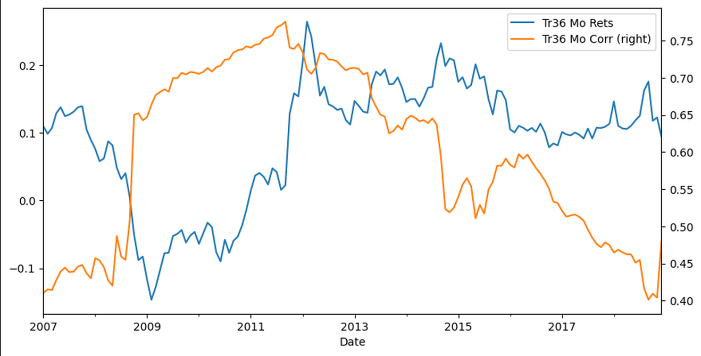 | Trailing 36-month returns and correlation from 2007 onward. | [Notebook 08](../notebooks/08_limits_of_diversification.ipynb) |

## Reading and reproducing the figures

1. Install the project dependencies from the repository root.
2. Launch JupyterLab from the repository root.
3. Run the source notebook linked in the figure table.
4. Check the notebook's data inputs and parameter cells before comparing results.

The notebooks are the authoritative source for calculations, parameters and interpretation. This directory is a presentation layer; it does not replace the underlying analysis.

## Scope and limitations

- The figures are selected outputs, not an exhaustive export of every notebook cell.
- Notebook 07 (liabilities and funding ratio) has no figure in this gallery because the supplied execution did not produce a chart for it.
- The market-cap-weighted extension depends on companion firm-count and average-firm-size datasets that are not included in this repository snapshot.
- Historical performance is not a guarantee of future results.
- GBM results depend on simplified constant-drift and constant-volatility assumptions.
- CPPI does not guarantee a floor under all market conditions; gap risk and discrete rebalancing can cause breaches.
- The analyses are educational research examples, not investment advice.

For project setup, the complete notebook sequence, data provenance and methodology notes, return to the [main project README](../README.md).
